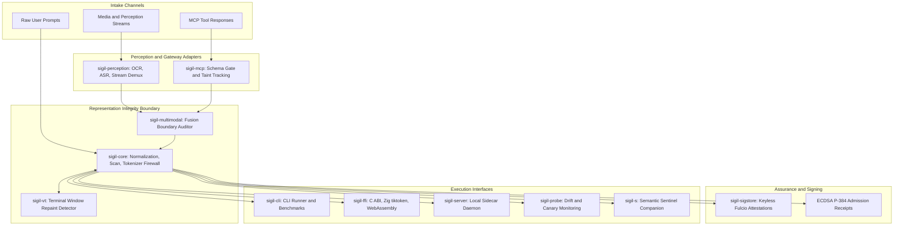
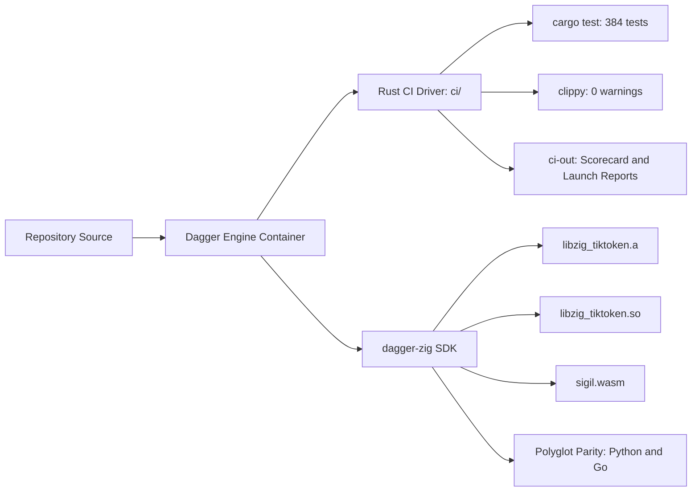

# SIGIL architecture

SIGIL enforces representation integrity between what security controls inspect and what an AI model executes. The engine prevents prompt injection, terminal escape tampering, and boundary loss during tokenization and multimodal fusion.

## Layered security architecture

The architecture consists of eleven modular crates:

### Core execution and boundaries

- `crates/sigil-core`: owns intake normalization, token boundary mapping, prompt injection detectors, data loss prevention scans, and cryptographic receipt generation using ECDSA P-384.
- `crates/sigil-vt`: provides virtual terminal window emulation to detect cursor repaints, line erases, and escape sequences that attempt to forge visual terminal output.
- `crates/sigil-s`: acts as the semantic sentinel companion layer, evaluating composite model risk scores without permitting lower-confidence assessments to weaken core security denials.

### Protocols and integration

- `crates/sigil-mcp`: gates tool responses from Model Context Protocol servers against declared schemas and injection signatures before output enters a prompt context.
- `crates/sigil-perception`: adapts binary assets into text channels, covering images with OCR, audio with speech recognition, video with stream demuxing, documents with render comparisons, and code with comment splits.
- `crates/sigil-multimodal`: audits fusion boundaries across heterogeneous channels to ensure that benign inputs do not synthesize malicious commands when combined.
- `crates/sigil-sigstore`: provides keyless signing through Fulcio OIDC tokens and verification of transparency log bundles.

### Services and operational interfaces

- `crates/sigil-probe`: monitors tokenizer health, canary token stability, and distribution drift metrics.
- `crates/sigil-server`: hosts local daemon endpoints and sidecar interfaces for containerized applications.
- `crates/sigil-ffi`: exports standard C ABI entry points and packages the WebAssembly reactor target.
- `crates/sigil-cli`: supplies operator commands, CI test runners, and performance benchmark suites.

## Containerized pipeline and toolchain architecture

All CI lanes and release builds execute inside reproducible Dagger containers, ensuring identical results across development machines and GitHub Actions runners.

For Zig compilation targets, the pipeline integrates with [dagger-zig](https://github.com/MChorfa/dagger-zig). This native Zig SDK for Dagger drives:

- Containerized compilation of `libzig_tiktoken.a` and `libzig_tiktoken.so`.
- Standalone compilation and validation of the `sigil.wasm` WebAssembly module.
- Verification of cross-runtime tokenization parity against Python and Go bindings.
- Differential conformance tests comparing the virtual terminal scanner with ghostty terminal tables.

See [SIGIL-SPEC.md](../SIGIL-SPEC.md) for the complete mathematical and behavioral specification.
